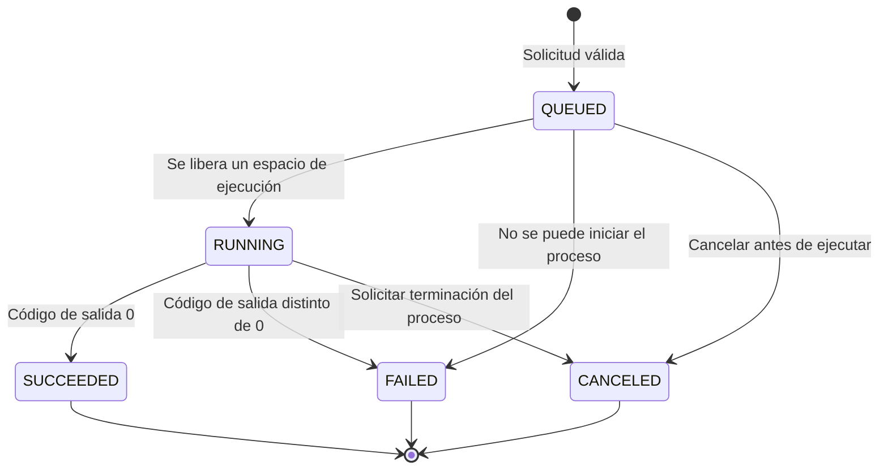

# Modelo de estados de los trabajos (RF-06)

Este documento describe los estados y la persistencia implementados en
BeanRunner.

## Estados implementados

| Estado | Tipo | Significado | Transición |
|---|---|---|---|
| `QUEUED` | Inicial / espera | El comando se validó y espera un espacio de ejecución. | Envío válido o espera detrás del límite de concurrencia. |
| `RUNNING` | Activo | El proceso hijo fue iniciado y se está supervisando. | El proceso terminó o se solicitó su cancelación. |
| `SUCCEEDED` | Terminal | El proceso terminó correctamente. | Código de salida igual a `0`. |
| `FAILED` | Terminal | El proceso terminó con error o no pudo iniciarse. | Código de salida distinto de `0` o error de lanzamiento. |
| `CANCELED` | Terminal | Se canceló un trabajo en cola o se terminó su proceso hijo activo. | Cancelación solicitada por el usuario o al cerrar la CLI. |

Cada trabajo conserva su ID, comando, estado, timestamps, PID si se inició el
proceso, código de salida, solicitud de cancelación y `stdout`/`stderr`. La CLI
interactiva y el servicio local guardan los metadatos al aceptar el trabajo,
iniciarlo, solicitar su cancelación y finalizarlo. Las salidas se guardan al
terminar el proceso. Al iniciar, los trabajos que quedaron `QUEUED` o `RUNNING`
se marcan como `FAILED` con una explicación de la interrupción; no se reanudan.

## Diagrama de transición implementado

## Invariantes

1. Solo las solicitudes válidas crean un trabajo.
2. Cada trabajo tiene un ID único y comienza en `QUEUED`.
3. El número de procesos activos no supera `max_concurrency` (por defecto 3).
4. La cola admite hasta 5 trabajos en espera por defecto; los envíos nuevos se
   rechazan explícitamente cuando alcanza su capacidad.
5. El proceso se ejecuta sin shell implícito y sus flujos se recolectan por
   separado.
6. Un trabajo terminado registra `finished_at` y, si se inició un proceso, su
   código de salida.
7. Los estados terminales implementados son `SUCCEEDED`, `FAILED` y
   `CANCELED`.

## Estado de trabajos interrumpidos

`INTERRUPTED` se propuso para reconocer trabajos que estuvieran ejecutándose
durante el reinicio o caída del daemon. No forma parte del enum actual: los
trabajos persistidos que estaban activos se marcan como `FAILED`, conservando
un mensaje que explica que fueron interrumpidos.
